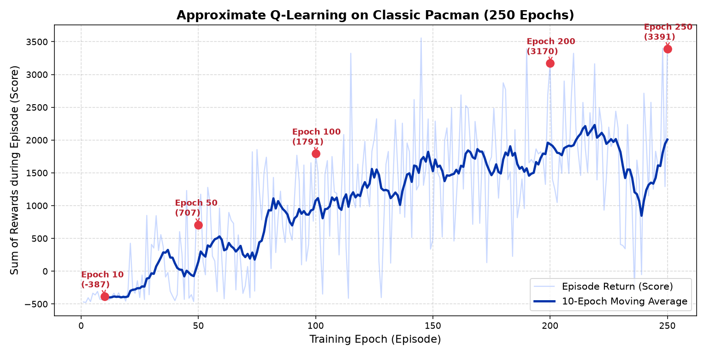

# Pac-Man Reinforcement Learning with Approximate Q-Learning (RL-Glue)

Dự án áp dụng **Học tăng cường (Reinforcement Learning)** với phương pháp **Approximate Q-Learning** cho trò chơi cổ điển **Pac-Man**, được thiết kế theo chuẩn kiến trúc **RL-Glue** (`BaseEnvironment`, `BaseAgent`, `RLGlue`).

## 1. Bảng Luật Pac-Man (Classic Arcade Rules)
- **Bản đồ mê cung cổ điển (`21 × 19`)**:
  - 180 hạt điểm thường (`Pellet`): **`+10`** điểm
  - 4 viên năng lượng lớn (`Power Pellet / Energizer`): **`+50`** điểm (chuyển 4 hồn ma sang trạng thái *Scared* trong 40 bước)
  - Ăn hồn ma đang hoảng sợ (*Scared Ghost*): **`+200`** điểm
  - Phạt mỗi bước di chuyển (*Living Step Penalty*): **`-1`** điểm
  - Va chạm hồn ma thường (*Active Ghost*): **`-500`** điểm (**GAME OVER**)
  - Ăn sạch toàn bộ hạt trên bản đồ (*Stage Clear*): **`+500`** điểm (**WIN**)
- **4 Hồn Ma với chiến thuật riêng**:
  - **Blinky (Đỏ)**: Truy đuổi trực tiếp vị trí của Pac-Man.
  - **Pinky (Hồng)**: Đón đầu vị trí cách Pac-Man 4 ô theo hướng di chuyển.
  - **Inky (Xanh lơ)**: Phối hợp gọng kìm cùng vị trí của Blinky.
  - **Clyde (Cam)**: Đuổi theo khi ở xa (> 6 ô), tản về góc dưới trái khi ở gần.

## 2. Phương Pháp Approximate Q-Learning
Xấp xỉ tuyến tính hàm giá trị hành động $Q(s, a)$ qua vector đặc trưng $\mathbf{f}(s, a) \in \mathbb{R}^9$:

$$Q(s, a) = \mathbf{w}^\top \mathbf{f}(s, a) = \sum_{i=1}^{9} w_i f_i(s, a)$$

Cập nhật trọng số theo sai số TD ($\delta$):

$$\delta = R + \gamma \max_{a' \in \text{Legal}(s')} Q(s', a') - Q(s, a), \qquad \mathbf{w} \leftarrow \mathbf{w} + \alpha \, \delta \, \mathbf{f}(s, a)$$

## 3. Kết Quả Huấn Luyện Qua Các Epoch `10, 50, 100, 200, 250`

| Mốc Huấn Luyện | Tổng Điểm (Return) | Số Bước (Steps) | Hạt Còn Lại (trên 184) | Trạng Thái |
| :--- | :---: | :---: | :---: | :--- |
| **Epoch 10** | `-387.0` | `17` | `171` | `CAUGHT BY GHOST` |
| **Epoch 50** | `+707.0` | `133` | `98` | `CAUGHT BY GHOST` |
| **Epoch 100** | `+1791.0` | `149` | `72` | `CAUGHT BY GHOST` |
| **Epoch 200** | `+3170.0` | `420` | `1` | `TIME LIMIT REACHED` |
| **Epoch 250** | **`+3391.0`** | **`309`** | **`0`** | **`STAGE CLEAR! (WIN)`** |

## 4. Cấu Trúc Thư Mục
- `Assignment 4 - Pacman Approximate Q-Learning.ipynb`: Jupyter Notebook chính trình bày lý thuyết, thực nghiệm huấn luyện, biểu đồ và video kết quả.
- `pacman_env.py`: Môi trường `PacmanEnvironment(BaseEnvironment)` theo chuẩn RL-Glue.
- `pacman_agent.py`: Bộ trích xuất đặc trưng `PacmanFeatureExtractor` và tác tử `ApproximateQAgent(BaseAgent)`.
- `mp4_writer.py`: Bộ kết xuất đồ họa Arcade `PacmanRenderer` và bộ mã hóa video `MP4Writer`.
- `train_and_record.py`: Kịch bản huấn luyện 250 Epochs và xuất video `Pacman_Approximate_QLearning.mp4`.
- `Pacman_Approximate_QLearning.mp4`: Video kết quả học tăng cường qua các Epoch `10, 50, 100, 200, 250`.
